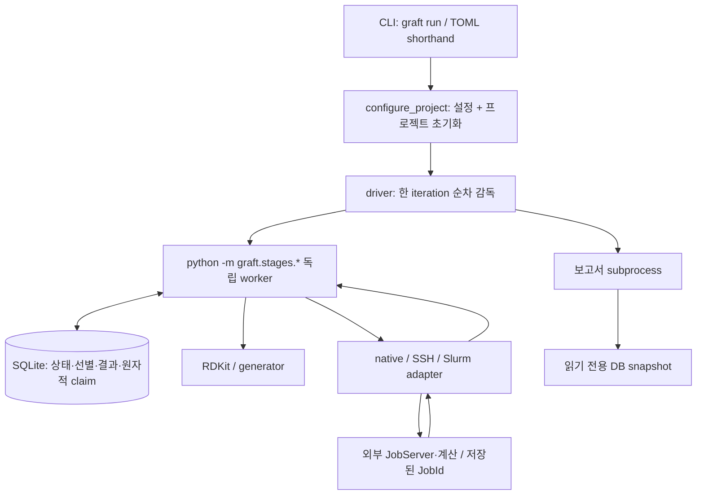

# Graft 전체 리팩토링 분석 및 계획

작성일: 2026-11-14 (KST)  
범위: **Phase 1 전체 분석 / Phase 2 계획 작성만 완료. 소스·테스트 변경은 승인 대기.**

## 1. 조사 기준과 증거의 범위

- 저장소 루트: `/homes1/chchae/work/GRAFT/graft`.
- 기준은 `392674a` 커밋만이 아니라 **현재 작업 트리 전체**다. `src/`, `tests/`, 문서에 미커밋 변경이 있으며 `reference_scores*.py`, `chemistry/selection.py`, `stages/crem_elites.py` 등 미추적 파일도 실제 코드에 포함된다. 이를 삭제·덮어쓰기하거나 HEAD 버전으로 되돌리지 않는다.
- `AGENTS.md`, `docs/SPEC.md`, `docs/DEVELOPMENT_HANDOFF.md`의 제약·최신 수정 사항·기준선·불확실성 항목과 `README.md`, `docs/architecture.md`, `pyproject.toml`을 검토했다. 오래된 문서의 표현을 최신 요구사항보다 우선하지 않는다.
- `src/graft` 전체 Python 파일을 AST로 조사했다. import, 함수 길이, 분기 노드, SQL 호출 위치, import 사용 후보를 추출하고, CLI·driver·설정·DB·계산/복구·화학·보고서·테스트의 주요 경로를 소스에서 추적했다. 모든 외부 런타임 조합을 실행 검증한 감사라는 뜻은 아니다.
- `examples/`의 TOML·실행 스크립트는 프로젝트 입력/운영 계층이다. `output*`, DB, native 결과, 임시 로그는 소스 분석 대상과 구분하며 production 입력·출력을 수정하지 않았다.
- 모든 제안은 **리팩토링 제안**이다. 코드의 현재 동작이나 구현 선택을 새 사용자 요구사항으로 승격하지 않는다.

### 정적 조사 수치

| 항목 | 현재 작업 트리 |
|---|---:|
| 패키지 Python 파일 | 110개 |
| 패키지 소스 줄 수 (주석·공백 포함) | 27,017줄 |
| 함수/메서드 AST 정의 | 952개 |
| `test_*.py` 파일 | 92개 |
| 위 테스트 파일 줄 수 | 24,298줄 |
| `test_*` 함수 정의 / pytest 수집 case | 1,379개 / 2,654개 |
| `_core.py` / `database.py` | 4,921줄 / 4,061줄 |
| `config.py` / `stages/glide.py` / `driver.py` | 917줄 / 669줄 / 595줄 |
| 반환형 주석이 있는 함수/메서드 | 52 / 952개 |

줄 수는 우선 조사할 위치를 찾는 지표이며, 그 자체가 분리의 근거는 아니다. 분기 노드 수 역시 정식 cyclomatic complexity 점수가 아니다. AST 통계는 문자열에 내장된 native Python 프로그램 내부를 별도 모듈로 세지 않는다.

### 이번 단계의 확인 결과

| 확인 | 결과와 한계 |
|---|---|
| `python -m pytest --collect-only -q -p no:cacheprovider` | 2,654개 수집 성공. **실행 통과 수가 아니다.** |
| `python -m graft --help` | 13개 subcommand와 TOML shorthand 안내 확인 |
| 실행 환경 확인 | Python 3.15.2, RDKit 2026.09.1, NumPy 2.5.4, pytest 9.2.0, Graft 0.1.0 |
| 직전 TOML 정리 작업의 검증 | 설정/CReM 테스트 222개 통과. 이번 분석의 전체 회귀 결과로 일반화하지 않는다. |
| 문서에 기록된 이전 전체 회귀 | SPEC 상단: 2,644 passed, 7 skipped, 기존 실패 3건. **이번 작업에서 재현한 결과가 아니다.** |
| production/native 계산 | 제출·취소·재실행·수동 점수 import 없음. 실제 과학 계산의 동등성은 미검증 |

전체 테스트 실행·characterization test 추가·패키지 재설치는 승인 후 Phase 3에 둔다. 지금은 새 문서만 작성한다. `pyproject.toml`은 Python >=3.11을 허용하지만 모든 허용 버전의 검증을 뜻하지 않는다. 현재 환경 한 곳의 성공으로 전체 Python 범위를 보증하지 않는다.

## 2. 현재 아키텍처와 실행 흐름

### 2.1 패키지 및 디렉터리 역할

| 위치 | 현재 역할 / 주요 경계 |
|---|---|
| `pyproject.toml`, `__main__.py`, `cli.py` | 설치 entry point `graft.cli:main`, `python -m graft`, TOML shorthand, subcommand 인자 전달 |
| `driver.py` | iteration 선택, 독립 worker subprocess 순차 감독, 완료/복구 장벽, 신호·로그·시간·report 감독 |
| `stages/` | stage CLI, DB 확인·claim, 계산 adapter 호출, 결과 저장·복구. 독립 실행 진입점도 제공 |
| `_core.py` | prototype 유래 호환 API, DB/schema/config/bootstrap, 화학·LibInvent, native helper 생성, docking·Prime orchestration까지 보유 |
| `database.py`, `states.py`, `paths.py` | workflow 상태·원자적 claim·선별 snapshot·결과·migration·복구 SQL, 상태 값, 신/구 output layout |
| `config.py` | 설정 검증·기본값·로컬/원격 경로. 일부 프로젝트 설정 조립·초기화는 `_core`에 남음 |
| `chemistry/` | RDKit descriptors, SA, scaffold/attachment, similarity, score/diversity, 2D combichem |
| `chemistry/combichem3d/` | 원자·pose lineage, assembly, CReM/probe/search, 충돌·최적화, native 입력 변환, cycle·export |
| `glide_*`, `ligprep_recovery.py`, `schrodinger_*` | 입력, 자원, JobServer/launch identity, timeout 결과, submission exclusion·retry |
| `amber_*`, `prime_gbsa_*`, `md_gbsa*` | 각 native/SSH/Slurm/local 계산 backend, durable manifest, recovery·수집 |
| `reference_scores*.py`, `remote_cleanup*.py`, `score_recovery.py` | reference cache 입출력, 명시적 retry, 결과 commit 후 cleanup 증거/영수증 |
| `distributions.py`, `distribution_html.py` | 읽기 전용 DB snapshot → descriptor/fingerprint 통계·HTML/JSON 보고서 |
| `tests/`, `tests/data/` | synthetic chemistry, SQLite·동시성·중단복구, native mock, 일부 설치 의존 I/O 검증 |
| `examples/`, `docs/` | target별 실행 입력/운영 자료, 요구사항·복구 근거·사용법. 계산 산출물은 별도 관리 |

### 2.2 점수 기반 pipeline



1. CLI는 `run`, stage 단독 실행, `status`, `report`, 독립 `combichem-3d`를 분기한다. TOML 경로만 주면 `run`으로 변환한다 (`cli.py:82`).
2. `_core.load_project_toml()`은 설정을 읽어 검증·경로 해석 후 dict를 반환한다. `_core.configure_project()`는 `SimpleNamespace`를 만들고 **DB migration, schema 보완, reference 초기화·descriptor 보완·cache 복원, 출력 디렉터리 준비**까지 수행한다 (`_core.py:4840`).
3. driver는 reference iteration 0의 미완료 작업, 기존 retry·manifest와 DB를 먼저 조사하고 iteration 하나를 고른다. `build_stages()`, `iteration_stages()`, `resume_iteration_stages()`는 활성 옵션뿐 아니라 저장된 작업의 회수를 반영한다.
4. 생성 iteration의 기본 순서는 Generate → Drug likeness → 선택적 synthetic → LigPrep → Glide → 선택적 Amber → 선택적 Prime → 선택적 MD-GBSA → 선택적 FEP export다. 단계 비활성화 뒤에도 기존 작업의 recovery가 삽입될 수 있다.
5. worker는 DB 확인·claim 후 과학 계산을 수행하고 결과를 저장한다. exit 0이나 출력 파일 존재만으로 driver가 완료 처리하지 않는다. native parent/children·불확실 제출·pending cleanup 등의 완료 장벽을 유지한다.
6. Glide reference group은 단계 내부에서 병렬 실행되고 완료 group을 즉시 저장한다. MD GPU admission과 CPU Prime frame 처리는 내부에서 겹칠 수 있다. 이를 driver 전체의 stage 병렬 실행으로 바꾸지 않는다.
7. CReM은 직전 iteration의 저장된 MD 기반 부모·pose ancestry·제약을 사용한다. 기존 combichem/LibInvent 및 독립 3D growth는 별도 생성 정책을 갖는다. LibInvent TL은 매번 original prior에서 시작한다.
8. FEP는 export/import이며 production 계산 protocol이 정의된 자동 실행이 아니다. report 실패는 과학 계산의 완료 여부를 바꾸지 않는다.

**사양의 불확실성:** `docs/architecture.md`는 worker 동시 실행 표현과 오래된 상태 사슬을 보유한다. SPEC §14는 historical scheduling 충돌을 미해결로 표시한다. 이번 계획은 현재 한 iteration 순차 감독 기준선을 유지하며 이 결정을 새로 해석하지 않는다.

## 3. 주요 문제와 실제 소스 근거

### A. 책임 집중과 역방향 의존성 — 확인됨

- `_core.py`에 설정 loader(`117`), schema(`236`, `279`), 상태 변경(`370`), reference import(`424`), LibInvent training 작성(`1957`), native extractor 생성(`2787`, `3401`, `4069`), docking(`3586`), Prime 실행(`4260`), 옛 iteration runner(`4680`), bootstrap(`4840`)이 함께 있다.
- `config.py`는 상단에서 `_core`를 import하고 `configure_project()`를 위임한다. 반대로 `_core.load_project_toml()`은 `config.py`의 다수 함수를 함수 내부에서 import한다. `database.connect()`도 `_core.open_sqlite()`에 위임한다 (`database.py:475`). 설정·DB의 기본 계층이 거대한 호환 core에 의존한다.
- `chemistry/similarity.py`는 fingerprint generator만 필요해도 `_core`를 import한다. `database.project_smiles()`·`import_crem_results()`도 canonicalization 때문에 core에 의존한다.
- 지연 import를 포함한 정적 그래프에서 **47개 모듈의 강연결요소**가 나타났다. `chemistry.combichem3d.output → database`, `database → chemistry.selection`, `stages.crem_generate → driver`, `driver → stages._summary → …` 같은 방향이 섞인다.
- 함수·클래스 본문 import를 제외한 별도 정적 조사에서는 module-level 순환을 발견하지 않았다. CLI import도 성공했다. **런타임 circular import 오류가 재현됐다는 뜻은 아니다.** 지연 import는 현재 성립하는 동작의 일부다.

원인 판단: prototype의 검증된 구현을 남기면서 stage·recovery 모듈을 증분 추가한 구조다. 작은 facade의 존재 자체가 결함은 아니며, 의존성 방향과 구현 소유권이 함께 정리되어야 한다.

### B. SQL 중앙화 미완료, 큰 transaction 경계 — 확인됨

- AST 기준 `.execute/.executemany/.executescript` 호출 지점 666개가 11개 파일에 분포한다. SQL 텍스트의 의미를 해석한 수치가 아니라 호출 위치 통계다. `database.py` 598개, `_core.py` 50개 외에도 CLI·driver·stage·CReM/Amber helper에 남아 있다.
- `cli._status()`는 SQL과 표시를 함께 수행한다. `driver.choose_iteration()`에도 raw SQL이 있다. synthetic/generate/ligprep/glide/Prime stage에 조회·갱신 SQL이 남는다.
- `_core.SQLiteCursor.execute()`는 `%s → ?`, `now() → CURRENT_TIMESTAMP`를 바꾸는 호환 계층이며, `db_connect()`가 현재도 사용된다. 이를 오래된 코드라는 이유만으로 삭제하면 안 된다.
- `database.py`는 compound workflow와 standalone growth 작업 DB, frozen shortlist, retry·cleanup·timing schema까지 다룬다. 많은 schema 보완이 사용 지점에서 수행되므로 DDL 순서 이동도 구형 DB 호환성 변경이다.
- `_score_diverse_rows()`는 DB 안에서 SMILES를 읽고 화학 selection을 호출한다 (`database.py:1067`). 이는 claim과 shortlist snapshot을 같은 transaction에 묶는 현재 정책과 연결된다. 단순히 화학 계산을 transaction 밖으로 옮기면 후보 경쟁 조건이 생길 수 있다.

### C. 긴 함수는 길이보다 정책 혼합이 문제 — 확인됨

| 함수 | 규모 | 함께 맡는 책임 |
|---|---:|---|
| `config.combichem_3d_settings()` (`12`) | 307줄 | 두 project mode 해석, 상속·override, 기본값, backend 검증, 경로·remote·Slurm 자원 검증 |
| `_core.run_reference_guided_docking()` (`3586`) | 252줄 | 구형 reference group 생성·제출·대기·결과 처리 |
| `_core.write_elite_libinvent_training_files()` (`1957`) | 236줄 | scaffold/elite 검증, 분해·vocabulary, TL 입력·로그 작성 |
| `_core.run_iteration_prime_gbsa()` (`4260`) | 221줄 | reference/generated, local/native batch 및 legacy queue 분기 |
| `stages.glide._run_stage()` (`440`) | 212줄 | recovery, 자원 예약·group 준비/제출·collect·commit |
| `chemistry.scaffold.prepare_iteration_scaffold()` (`238`) | 171줄 | saved snapshot, generation 방법·고정/적응형·fallback 정책 |
| `md_gbsa.run()` (`250`) | 156줄 | frozen selection, MD admission, local Prime frame 처리, 결과·실패·cleanup |
| `driver.supervise_iteration()` (`357`) | 129줄 | stage 선택/전환, 재시도, native/DB 완료 장벽, 시간·경고·report |

가장 위험한 분기를 먼저 공통화하지 않는다. 입력 검증/계획 구성/명령 생성/완료 판정처럼 관찰 가능한 경계를 테스트로 고정한 뒤 작은 함수로 분리한다. 단순히 줄 수만 줄이는 wrapper 추출은 하지 않는다.

### D. 중복·유사 구현 — 존재하지만 통합 범위를 제한해야 함

8줄 이상 함수 본문을 비교한 AST 조사에서 완전히 같은 함수 본문은 발견하지 못했다. 아래는 **의미 비교가 필요한 유사 코드**다.

| 후보 | 실제 위치 | 구분해야 할 차이 / 권장 범위 |
|---|---|---|
| JSON 임시 파일·replace | `amber_gbsa.save`, `prime_gbsa_async._save`, `glide_recovery.save_record`, `ligprep_recovery._save`, `md_gbsa_native.save`, `combichem_writer._publish` | 파일명·encoding·indent·newline·fsync·디렉터리 sync가 다름. 같은 계약인 로컬 저장만 후보; native 단독 helper와 durable journal은 별도 유지 |
| SSH 실행 wrapper | `reinvent_remote._ssh`, `amber_gbsa.ssh`, `md_gbsa.ssh`, distributed `RemoteSearch` | SSH config, timeout, stdin/stream, remote error/UNKNOWN 의미가 다름. 공통 wrapper 강제 적용 금지 |
| Morgan r2/2048 generator | `_core.FP_GENERATOR`, `chemistry/similarity.py`, `chemistry/selection.py`, `distributions.FP`, `combichem3d.Evaluator` | 같아 보이는 파라미터와 chirality·tie·형변환을 대조. 우선 `_core` 역의존을 끊는 작은 chemistry helper만 검토 |
| 배치 process pool | `chemistry/sa_score.calculate_sa_scores`, `chemistry/descriptors.calculate_rdkit_descriptors_batch` | CPU affinity·chunksize·순서·빈 입력 처리 유사. 예외·이미 계산한 SA 재사용 계약이 다르므로 일반 batch framework는 도입하지 않음 |
| 유한 좌표·count·host 검증 | `config.attraction_point_settings`, `glide_pose_selection.validate_point`, backend별 validator | 외부 오류 문구·수용 타입·검증 시점까지 다를 수 있음. 동일 계약 확인 후 순수 predicate 정도만 공유 |

반대로 `ProbeBuffer.save()`의 JSON snapshot, pose/history 좌표 복원, `Chem.Mol` 복사는 변경 가능한 report·분자·소수점 정밀도를 분리하기 위한 것이다. 이를 불필요한 변환·복사로 간주하여 제거하지 않는다.

### E. 전역 상태·숨겨진 부작용 — 확인됨

- `_core.configure_project()`는 순수 설정 함수가 아니다. `cli._status()`도 이를 호출하므로 현재 status 경로가 migration/reference 보완을 수행할 수 있다. 이번 리팩토링에서 몰래 read-only로 바꾸지 않는다. 반면 `distribution_project()`와 `database.distribution_snapshot()`은 명시적 읽기 전용 경계다.
- `combichem_distributed.install()/uninstall()`은 `_ORIGINAL_WORKER`를 저장하고 다른 모듈의 `worker_loop`를 교체한다 (`stages/combichem_distributed.py:18`). backend 선택이 한 프로세스 안에서 호출 순서에 의존한다.
- `combichem_compute.mcs()`는 logger handler/level을 잠시 바꾼 뒤 `finally`에서 복구한다. `_logging.py`는 contextvars로 타이머·log level을 전달한다. 단순 전역 변수로 바꾸거나 protocol marker를 logger로 흡수하면 안 된다.
- `_core.FP_GENERATOR`, descriptor catalog cache, native helper의 module constant는 공유 상태다. 모두 제거해야 하는 상태는 아니며 결정성·process 시작 방식을 함께 보아야 한다.
- `SimpleNamespace`에 설정 외에 `initial_mcs_smarts`, `iteration_mcs`, `attachment_query_indices` 등 runtime 정보가 추가되고, driver는 단계 경계에서 `md_gbsa_enabled`를 TOML로 다시 읽는다. 설정을 무조건 frozen dataclass로 바꾸면 현재 hot-read 동작을 잃는다.

### F. 오류·출력·자원 관리 — 확인된 구조와 미확인 위험을 구분

- `JobStatusUnavailable`, `RemoteCalculationError`, `PrimeAtomTypingError`, `PoseGeometryError`처럼 구체적인 예외가 이미 있다. broad `except Exception`도 여러 곳에 있지만 UNKNOWN 보존, 진단 후 재전파, 독립 결과 수집 등의 이유가 있다. 일괄 축소하지 않는다.
- `print`, 단계별 level wrapper, 표준 logging이 혼재한다. 특히 `__GRAFT_WORK_STARTED__`, `[MCS]`, pending summary와 stdout/stderr는 driver와의 protocol이다. 출력 정리는 외부 동작 변경 위험이 크다.
- `database.claim_compounds()`는 명시적으로 rollback·close한다. `database.distribution_snapshot()`도 `finally: close()`한다. 반면 많은 `with database.connect(...)`/`with open_sqlite(...)`는 sqlite Connection context manager다. 이 context는 transaction을 처리하지만 **연결 종료까지 보장하지 않는다**. 객체 수명에 의존하는 자원 관리 위험은 확인되지만 실제 production 누수는 이번 조사에서 측정하지 않았다.
- `driver.stream_process()`는 종료 시 terminate/wait/kill, stdout close를 수행한다. `RemoteSearch.start()/close()` 등은 handshake 실패·두 번째 wait timeout·pipe 정리 경계를 추가 검증할 가치가 있다. 재현 없는 결함 확정이나 조용한 cleanup 동작 변경은 하지 않는다.
- `read_bytes()` 기반 checksum과 큰 파일 로드는 존재한다. streaming checksum 전환은 이번 범위에서 성능 최적화와 함께 섞지 않는다.

### G. 사용 여부와 문서 부채

- 정적 미사용 import 후보: `_core.argparse`, `stages.generate.sqlite3`, `stages.glide.sqlite3`, `stages.combichem_slurm_pool.json`, `stages.combichem_3d.assemble`, `stages._deleted_md.Path`. 패키지 내부 re-export, monkeypatch, 문자열 내장 script, 외부 import 가능성을 확인하기 전에는 제거 확정이 아니다.
- `_core.run_iteration()`은 `src/tests`의 직접 호출 검색에서 정의 외 호출을 찾지 못했다. `select_global_elites()`는 과거 전체 iteration 기반 ranking 의미를 포함한다. 현재 stage 경로와 다르지만 외부 스크립트 사용을 확인할 수 없으므로 **사용 불확실 legacy API**로 표시하고 보존한다.
- `run_reference_guided_docking()`은 위 legacy runner에서 호출된다. `run_iteration_prime_gbsa()`는 현재 `stages/prime_gbsa.py:117`과 여러 테스트가 호출한다. 이름이 오래됐다는 이유로 죽은 코드로 분류하면 안 된다.
- `_core` 내부의 긴 문자열 helper, `Path(__file__).with_name(...)`로 전송하는 native/remote helper, `python -m graft.stages.*`, `md_gbsa_dispatch`의 파일 기반 동적 import는 단순 import 그래프에 안 보이는 사용이다.
- SPEC/HANDOFF/REBUILD_PROMPT에 같은 변경 기록이 반복되지만 요구·구현·증거·superseded 이력이 섞여 있다. 먼저 현재 계약 색인을 만들고, 기록 삭제·요구사항 재작성은 별도 검토한다.

## 4. 데이터 흐름과 보존해야 하는 계약

| 경계 | 전달 데이터와 현재 보장 | 리팩토링 위험 / 필요한 검사 |
|---|---|---|
| TOML → 설정 | hyphen/legacy alias, default, TOML 상대 로컬 경로, absolute remote 경로, bool/int 검증, dict/Namespace | precedence·default·에러 발생 시점 변경. dotted `combichem-3d.*`도 기존 table과 동등해야 함 |
| reference → compound | 원래 분자 하나당 row 하나, title/CMPID·isomeric SMILES·기존 experimental/score 보존 | row 순서·ID·중복 처리·finite 판단 변경 |
| 생성 → 저장 | canonical/DB-wide 중복 제거, target/exhaustion, descriptors·ancestry·snapshot/cursor | 계산 전/후 validate 순서와 commit 단위, mutable history 공유 변경 |
| CReM/local 계산 → writer | batch/ordinal, JSONL, checksum, `.ready`, SQLite commit 후 파일 ack | crash replay·fsync·claim ownership·backpressure 변경. writer는 stage 내부 persistence 보조이지 다른 stage worker가 아님 |
| LigPrep → Glide | `CMPID_<id>`를 여러 state에서 유지, reference/core mapping, pose-score pair | state 수를 원분자 수로 혼동하거나 pose와 score를 별도로 선택하는 회귀 |
| 점수 → shortlist/claim | contact tier, score source, deterministic diversity·ties, frozen membership, 이미 계산한 row의 순위 | 계산을 transaction 밖으로 옮기거나 실패 member를 lower rank로 채우는 회귀 |
| submit → recover | intent → 정확한 command/JobId → parent/child query → 검증·수집 → DB commit | reply 유실 때 중복 제출, exit 0/cached output을 완료로 해석하는 회귀 |
| MD → GBSA | 저장된 selection, replica/frame 수, MD GPU slots, native Prime/local shared backend | MD-only 완료를 ensemble 완료로 오해, 실패를 finite energy로 치환 |
| DB commit → cleanup/cache | checksum·ownership·native 종료·local 수집 확인, cleanup receipt, reference cache signature | 원격 결과 조기 삭제, 성공 cache 덮어쓰기, 입력 파일의 비점수 정보 변경 |
| DB → report/FEP | 읽기 snapshot, 안정된 선택·score source, 기존 출력 schema·경로·열 | 진단이 workflow를 변경하거나 파일 포맷·native metadata가 달라지는 회귀 |

`None`, finite 값, 미계산, 영구 실패, UNKNOWN은 서로 다른 상태다. 이들을 하나의 falsey 검사나 공통 exception으로 통일하지 않는다.

추가로 유지할 기준은 다음과 같다. 이는 새로운 계산 조건 제안이 아니다.

- SQLite가 workflow를 조정하고 driver는 감독만 한다. worker가 다른 stage worker를 호출·조정하도록 바꾸지 않는다.
- native Prime의 기존 project-wide 7-job 제한, 새 작업의 native batching, legacy individual queue 회수, 프로젝트 간 Glide/Prime submission exclusion을 유지한다. 별도 local/shared backend의 검증된 CPU 예산을 하나의 새 전역 숫자로 통합하지 않는다.
- LigPrep 기본 pH 7.4, tolerance 1.0, Epik states 2, stereoisomers 1과 설치 버전별 native 명령 제약을 보존한다. 2026-3 환경에 `-r 1`을 새로 추가하지 않는다.
- constrained SP docking, core mapping, no-unconstrained-fallback, 저장된 attraction-point 정책, pose와 점수의 대응을 보존한다. contact 우선 정책을 포함한 현재 코드의 선별 의미를 단순 최저 점수 규칙으로 되돌리지 않는다.
- LibInvent scaffold `[*]`와 decoration `*`의 구분, hydrogen decoration adapter, Morgan radius 2/2048-bit Tanimoto, immediately preceding iteration의 elite와 original-prior TL을 유지한다.
- FEP 기본 비활성 및 export/import 지원, 기존에 명시적으로 활성화된 프로젝트의 동작을 모두 유지한다. 로컬 경로는 TOML 기준, 원격 경로는 원격 경로로 보존한다.

## 5. 가장 위험한 영역과 배포 제약

1. **Critical — 구현 fingerprint.** `stages/crem_generate._fingerprint()` (`37`)는 `chemistry/combichem3d/*.py`와 생성 관련 stage 소스 checksum을 저장한다. `md_gbsa.settings_for()/prepare()` (`164`, `188`)는 helper checksum을 고정한다. `reference_scores.context()` (`31`)도 Amber/MD helper implementation digest를 cache 조건에 포함한다. `combichem_remote.dispatch()`는 distributed helper를 fingerprint에 포함한다. **동일한 계산을 수행하는 주석 수정·파일 분리도 기존 미완료 작업이나 cache 재사용을 거부할 수 있다.**
2. **Critical — DB transaction과 복구.** readiness + final shortlist + claim의 원자성, 성공 결과의 보호, WAL migration, frozen selection, interrupted intent/JobId, 삭제된 iteration의 명시적 복구를 보존한다.
3. **Critical — cleanup과 reference writeback.** 제출·취소·삭제/이동·캐시 주석 기록은 함수 추출보다 훨씬 큰 부작용이다. production 입력·DB·remote helper는 이번 분석에서 손대지 않는다.
4. **High — 과학적 identity.** stereo, isotope/charge, atom index·pose ancestry, constrained docking, original prior, score precedence·tie·seed를 동일하게 유지한다.
5. **High — 여러 backend/legacy format.** individual queue, native batch, shared/local Prime, SSH, Slurm는 하나의 일반 job interface로 합치는 대상이 아니다. 이름/키/경로도 restart API다.

배포 원칙: 구조 변경은 별도 작업 트리/검증 환경에서 준비하고, 운영 프로세스가 다음 invocation에 수정 소스를 읽는 shared editable installation에 중간 상태를 노출하지 않는다. **완료 전 작업이 관련 fingerprint를 참조하면 해당 파일의 구조 변경 배포를 보류**하거나, 별도 버전 설치로 새 프로젝트부터 검증한다. 무검증 old-hash allowlist, fingerprint 검사 우회, saved manifest rewrite, native helper 덮어쓰기·live job reset은 계획에 포함하지 않는다. 이것은 재개 동등성을 확보하기 위한 배포 제약이며 검사를 약화하라는 제안이 아니다.

## 6. 권장 아키텍처

현재 패키지를 유지하면서 다음 책임 경계를 만든다. 새 framework/ORM/DI container/추상 backend class는 도입하지 않는다.

```text
cli / __main__
  ├─ config: 순수 파일 읽기·검증·경로/기본값 해석
  ├─ project 초기화 경계: 명시적 DB/reference 준비 (필요성이 입증될 때 project.py)
  ├─ driver: iteration/stage 감독·완료 장벽·프로세스 제어
  ├─ stages: 해당 단계의 준비·claim 요청·adapter 실행·commit 요청
  └─ distributions: 읽기 전용 보고서

공통 하위 기능
  database.py: SQL·transaction·migration·claim·frozen result의 구현 소유자
  states.py / paths.py: 상태와 신·구 경로 해석의 단일 소유자
  chemistry/: 분자/pose/selection 정책; I/O 결합은 경계에서만
  현재의 native/remote/recovery 모듈: backend별 명령·manifest·완료 증거

_core.py: 이동 완료된 함수의 호환 진입점 + 아직 추출하지 않은 검증된 구현
```

- `database.py`를 처음부터 package 여러 개로 쪼개지 않는다. core/stage의 SQL 소유권과 transaction 경계부터 모은다. 파일 길이보다 책임의 단일성을 우선한다.
- `config.py`가 `_core`에 의존하지 않고 기본 설정을 완성하도록 한다. 초기화는 명시적 함수 경계로 분리하되 기존 `configure_project()`의 시그니처·부작용·시점을 보존한다.
- 작은 순수 chemistry 기능부터 core 역의존을 줄인다. DB가 소유해야 하는 atomic selection을 분리할 때도 transaction 소유권은 유지한다.
- `_core` facade는 제거 목표가 아니다. 외부 호출 가능성이 해소되지 않은 기능은 계속 제공한다. 테스트 monkeypatch 지점도 호환을 조사한다.
- 설정과 persistent JSON 전체를 한 번에 dataclass로 바꾸지 않는다. 작은 결과 tuple/manifest 계약에 한해서 `TypedDict` 또는 명확한 타입 주석을 우선 검토한다. serialization wire format은 그대로 둔다.
- native standalone script는 vendor Python에서 Graft 설치 없이 동작하는 경계를 보존한다. 공통 import를 추가하려면 배포 파일·helper hash·복구 계약을 먼저 검증한다.

## 7. 테스트 현황과 보완 계획 (구조 변경보다 선행)

### 7.1 이미 있는 강점

- `test_database`, `test_states`, `test_stage_barriers`, `test_iteration_completion`: schema·state·원자적 claim·완료 장벽.
- `test_sequential_driver`, `test_driver_logging`, `test_stage_timing`, `test_workflow`, `test_project_config`: 감독·CLI 인자·logging·elapsed·설정.
- `test_glide_*`, `test_prime_gbsa_*`, `test_schrodinger_*`: JobId/recovery/UNKNOWN, timeout·batch·자원·submission fencing.
- `test_combichem_*`, `test_crem_*`: 실제 RDKit 구조·stereo·ancestry·cursor, local/remote/Slurm·writer replay.
- `test_md_*`, `test_reference_*`, `test_remote_cleanup`, `test_deleted_*`: ensemble, retry, cache, 삭제 복구와 ownership.
- `tests/conftest.py`는 submission mutex와 MD remote registry를 tmp 경로로 격리한다. 이런 보호를 유지한다.

테스트가 전반적으로 없다는 진단은 부정확하다. 실제 부족한 부분은 아래 **횡단 계약과 배포 호환성**의 명시적 검증이다.

### 7.2 선행 characterization 묶음

| 묶음 | 우선 검증할 현 동작 / 대표 입력·출력 | 기존 테스트와 추가 후보 |
|---|---|---|
| C1. CLI·설정 | TOML shorthand/명시 command, 인자/return code/stdout·stderr, default·alias·잘못된 값, 상대/원격 경로, CReM table/dotted 동등성 | 기존 `test_project_config`, `test_workflow`, `test_sequential_driver`; 필요 시 `test_cli_contract.py` |
| C2. 초기화·DB | fresh/legacy WAL·schema, reference cache marker, status의 현 부작용, missing descriptor, rollback·예외·연결 소유권 | `test_database`, `test_reference_score_cache`; 필요 시 `test_project_initialization_contract.py` |
| C3. 선정·영속화 | score tie/finite/UNKNOWN/contact tier/diversity seed, 기존 점수의 순위, 실패 member의 no-refill, atomic claim 경쟁 | `test_score_diversity`, `test_amber_selection`, `test_stage_barriers`; 기존 fixture 확대 우선 |
| C4. job transcript | intent 직후·JobId 저장 직전/직후 crash, parent/child UNKNOWN·부분 완료, 실패 group 옆 성공 group의 즉시 commit | `test_glide_*`, `test_prime_gbsa_launch_recovery`, `test_md_gbsa_jobcontrol`; 대표 saved manifest·status 응답 fixture |
| C5. 생성/출력 | 원자·stereo·exact coordinates/history·원분자 ID, full ensemble·reference cache·FEP CSV/TSV·SDF schema/순서, 빈/불완전·invalid 입력 | 기존 chemistry/CReM/reference/FEP/report 테스트; `tests/data/refactoring/`은 작은 synthetic/비식별 fixture만 |
| C6. crash·자원 | writer commit 전후/ack 전후, file replace 실패, subprocess handshake/stream/interrupt, signal 전후 lock·pipe·connection, 반복 backend 선택 복구 | `test_combichem_writer/buffer`, `test_remote_cleanup`, `test_driver_logging`, `test_combichem_remote`; 필요한 failure injection 추가 |
| C7. 재개·배포 | 변경 전 포맷 manifest의 읽기·원래 command/JobId 보존, source hash mismatch의 현재 거부 동작, native script 단독 실행/import 해석 | 기존 fingerprint/recovery 테스트 + old-format fixture·helper deployment contract 테스트 |

비결정적 UUID·시각·임시 경로는 fixture에서 고정하거나 명시적으로 정규화하고, 분자 ID·score·선택 순서·command 인자·출력 열은 정규화하지 않는다. 과학 값에 새로운 허용 오차를 임의로 부여하지 않는다. 외부 계산은 mock transcript로 제어하며 과학적 정확성 검증으로 표시하지 않는다.

### 7.3 기준선과 의심 동작의 처리

- 승인 후 **소스 수정 전** 전체 pytest를 실행하여 환경·명령·종료 코드·실패 node ID·skip 사유·warning을 보관한다. 기존 실패를 무시하는 전역 xfail·assert 완화는 하지 않는다.
- SPEC의 과거 실패: `test_combichem_3d.py::test_real_probes_pass_but_actual_fragment_combination_collides_with_itself` 1건과 MD pending-log expectation 2건. 소스에는 `test_md_progress_summary.py::test_driver_pending_line_includes_progress_and_elapsed_even_on_worker_error[0/1]`가 있다. 실제 현재 실패 일치 여부는 기준선 실행에서 확인한다.
- 위 기존 실패, bool coercion 차이, status 초기화 부작용, DB/pipe 누수 의심은 별도 조사 항목이다. 현재 코드/테스트/요구가 충돌하면 실제 관찰과 기대 계약을 함께 기록하고, 테스트를 현재 구현에 맞추려고 조용히 고치지 않는다.
- 실서비스 다중 호스트 JobServer/Slurm·GPU·라이선스 및 장시간 장애 복구는 mock만으로 입증할 수 없다. 대표 포맷 fixture와 권한이 있는 별도 소형 프로젝트가 필요하다. 이 계획 승인이 production scientific smoke test 제출 권한까지 뜻하지는 않는다.
- FD/pipe 수명, ENOSPC/replace 실패, process backend 연속 전환, 전체 CLI/output schema의 공통 계약을 아우르는 검증은 현재 조사만으로 충분하다고 입증하지 못했다. 기존 테스트에 같은 case가 있으면 재사용하고 누락된 case만 추가한다. 코드와 똑같은 계산을 다시 구현하는 테스트는 피한다.

## 8. 실행 작업 목록

아래 **T0를 통과하기 전에는 T1 이후 소스를 수정하지 않는다.** 각 작업은 변경 설명 → 관련 테스트 사전 실행 → 최소 수정 → 같은 테스트 재실행 → 필요한 전체 회귀 → 결과/호환성 기록 순서로 수행한다. 서로 다른 항목을 한 대형 patch로 합치지 않는다.

### T0. 보존 테스트·배포 기준선 확보 — Critical

- **대상:** `tests/`와 필요 시 작은 `tests/data/refactoring/`; `pyproject.toml`의 실행 환경 정보. source 변경 없음.
- **현재 문제:** 많은 unit/recovery 테스트가 있지만 현재 전체 실행 결과와 변경 전 wire/CLI·fingerprint 호환 계약을 이번 작업 기준으로 고정하지 않음.
- **권장 수정:** §7의 C1–C7을 기존 fixture로 먼저 검증하고 부족한 경계만 characterization test로 보강한다. 미커밋 파일까지 작업 snapshot에 포함하고 운영 editable installation과 분리한 검증 경로를 확정한다.
- **효과:** 구조 변경 회귀와 기존 실패를 구별할 기준선 마련.
- **기능 영향/위험:** 테스트·fixture만 추가. native 결과·제출·production DB는 변경하지 않음.
- **검증:** 전체 pytest 원본 결과, CLI help/인자 계약, legacy/fresh DB·manifest fixture와 no-native-submit assertion. fingerprint가 바뀌는 파일은 배포 보류 조건을 먼저 확인.

### T1. 안전한 미사용 코드 식별·정리 — Low

- **대상:** §3G의 6개 import 후보, `_core.run_iteration`, `select_global_elites`의 호출 조사.
- **현재 문제:** 옛 runner와 호환 adapter, 실제 사용 import가 정적 미사용 후보와 섞임.
- **권장 수정:** import·attribute 사용, tests monkeypatch, CLI/module entry point, 문자열 script·업로드·동적 import와 외부 스크립트 사용 여부를 확인한다. 입증된 로컬 미사용 import만 소규모로 제거한다. legacy API는 확인 불가 목록에 남겨 보존한다.
- **효과:** 의미 없는 의존성과 잔재를 줄이되 기능 제거를 방지.
- **기능 영향/위험:** 낮음으로 입증된 후보만. fingerprint에 들어간 파일은 동작 변화가 없어도 배포 위험 Critical이므로 보류 가능.
- **검증:** 제거 전/후 import·CLI collection/관련 테스트; `python -m`/업로드 helper 참조 재검사. 함수 삭제는 별도 근거 없으면 시행하지 않음.

### T2. 작은 순수 chemistry 의존성 분리 — Medium

- **대상:** `_core.FP_GENERATOR`/`canonicalize_smiles`, `chemistry/similarity.py`, `database.project_smiles`·`import_crem_results`; 필요할 때만 작은 기존 chemistry 모듈 확장.
- **현재 문제:** 기본 분자 정규화·similarity가 대형 core 전체를 참조하고 역의존을 늘림.
- **권장 수정:** 이미 테스트된 순수 함수·동일 파라미터의 generator 구현 소유권을 chemistry로 이동하고 core는 기존 호출 경로를 제공한다. score diversity/report/3D evaluator까지 일괄 통합하지 않음.
- **효과:** DB/chemistry의 core 의존 감소, 독립 검증 가능.
- **기능 영향/위험:** stereo·invalid/empty 처리·None/exception·tie가 달라질 수 있어 수치/반환 계약을 그대로 유지. fingerprint 대상 chemistry 파일은 §5 적용.
- **검증:** C2/C3/C5, similarity·reference assignment·SMILES dedup·descriptor/score diversity·CReM tests. 기존/새 경로 반환값과 예외 대조.

### T3. DB 구현 소유권과 transaction 경계 정리 — High

- **대상:** `_core.open_sqlite`, `create_sqlite_schema`, `ensure_schema_columns`, `set_compound_state`; `database.py`; `cli._status`, `driver.choose_iteration`; 단계에 남은 SQL.
- **현재 문제:** DB API가 core를 호출하고 raw SQL이 여러 orchestration 경로에 흩어짐. Connection 소유권 표기가 혼재함.
- **권장 수정:** 먼저 작은 조회를 의미 있는 database 함수로 옮기고, 이후 연결/schema/state primitive의 구현 소유권을 database로 이동한다. 기존 facade·SQLiteCursor 변환 API는 유지한다. query와 print를 분리하되 출력·초기화 순서는 보존한다. claim/selection/commit을 별 transaction으로 쪼개지 않는다.
- **효과:** SQL·migration 변경 위치가 명확해지고 core 역의존 감소.
- **기능 영향/위험:** 높음. connection/transaction factory 교체는 public 반환형과 context 의미를 바꿀 수 있음. 자동 close 의미 변경·실제 누수 수정은 증거를 갖춘 별도 버그 patch로 분리.
- **검증:** C2/C3/C4/C6, WAL backup·foreign keys·busy timeout, 동시 claimer disjointness, rollback, legacy schema·scored ranking·no-refill, DB 상태와 실패 진단의 변경 전/후 비교. 전체 회귀 필수.

### T4. 순수 설정과 초기화 부작용 분리 — High

- **대상:** `_core.load_project_toml`, `_core.configure_project`, `config.py`의 `combichem_3d_settings`·`configure_project`; 필요성이 확인되면 `project.py` 초기화 함수; CLI/driver 진입부.
- **현재 문제:** config가 core에 역의존하고 307줄 validator가 project merge·backend·경로·검증을 섞음. 설정 API 이름으로 초기화가 호출됨.
- **권장 수정:** loader의 구현을 config가 소유하게 하고, 3D merge/default/path/backend 검증을 순서가 명확한 작은 순수 함수로 분리한다. 초기화는 단일 명시적 함수로 모으되 기존 configure facade와 부작용·예외 시점은 보존한다. Namespace를 한 번에 dataclass로 교체하거나 새 TOML schema를 요구하지 않는다.
- **효과:** 파일 읽기/검증만의 테스트, 초기화 시점 추적, 기본값·alias 변경 위험 감소.
- **기능 영향/위험:** 높음. 설정 override·debug scaling·MD hot-read·native suite 우선순위와 잘못된 입력의 최초 오류가 바뀔 수 있음.
- **검증:** C1/C2/C7, `test_project_config`, `test_combichem_3d`, `test_crem_pipeline`, reference cache·host/path tests. 대표 TOML의 전체 유효 설정 dict/경로와 실패 종류·메시지·발생 순서 대조. 전체 회귀 필수.

### T5. 동일 계약의 중복만 통합 — Medium

- **대상:** `amber_gbsa.save`, `prime_gbsa_async._save`, `glide_recovery.save_record`, `ligprep_recovery._save`의 로컬 persistence; §3D의 검증·batch 후보.
- **현재 문제:** 유사 구현이 분산되어 수정 누락 위험이 있으나 durability/format 차이를 공유 구현이 숨길 가능성도 큼.
- **권장 수정:** T0에서 byte format·temp 이름·replace·실패 보존 계약이 같은 것으로 입증된 묶음만 작은 함수로 통합한다. 의미가 다른 native helper, fsync journal, streaming SSH, 일반 batch pool은 우선 그대로 둔다. 효과가 작으면 통합하지 않는다.
- **효과:** 동일 정책의 중복 수정 최소화. 범용 utility를 위한 utility를 만들지 않음.
- **기능 영향/위험:** 중간~높음. 파일 쓰기 원자성·stderr·시점·newline은 외부 계약일 수 있음. durability 강화/직렬화 포맷 변경은 별도 작업.
- **검증:** C4/C6/C7, byte/JSON field contract, replace/쓰기 실패 후 이전 파일 보존, lost-response recovery, stage lock 중복 실행. helper의 독립 배포 의존성 검사.

### T6. 긴 orchestration 함수의 정책 경계 정리 — High

- **대상:** `stages.glide._run_stage`, `_core.run_iteration_prime_gbsa`, `md_gbsa.run`, `driver.supervise_iteration`; 이후 `write_elite_libinvent_training_files`, `prepare_iteration_scaffold`.
- **현재 문제:** 준비·검증·native side effect·DB commit·진단이 긴 분기에서 섞여 변경 파급 범위가 큼.
- **권장 수정:** **각 함수 하나씩** 입력 계획 구성, 저장된 work 복원, 완료 판정, 결과 검증/commit 호출을 분리한다. state와 I/O 순서를 명시하고 함수 간 필요한 데이터만 전달한다. backend/state machine의 의미나 retry 횟수는 바꾸지 않는다. driver에 화학 계산을 넣지 않음.
- **효과:** 어느 분기가 제출/회수/저장하는지 추적 가능하고 작은 정책 테스트가 가능해짐.
- **기능 영향/위험:** 높음. group별 즉시 저장, 병렬 슬롯, UNKNOWN 보존, exception 전파, original-prior·scaffold fallback이 달라질 위험.
- **검증:** C3–C7의 이벤트 transcript·DB/output 대조. `test_glide_*`, `test_prime_gbsa_*`, `test_md_*`, `test_sequential_driver`, LibInvent/scaffold tests. 의미 있는 하위 묶음마다 전체 회귀. 계산값·selected membership·명령·부작용 순서 변경 시 중단/복구.

### T7. backend 선택의 전역 함수 교체 제거 검토 — Medium

- **대상:** `combichem_distributed.install/uninstall`, `combichem_remote.dispatch`, `stages.combichem_3d`의 worker 시작부.
- **현재 문제:** `_ORIGINAL_WORKER`·module attribute mutation 때문에 같은 프로세스의 backend 연속 실행이 숨겨진 이전 호출에 의존.
- **권장 수정:** local/SSH/Slurm 구분을 명시적 callable 선택으로 전달하는 최소 변경을 검토한다. 새 클래스 계층은 만들지 않는다. native와 multiprocessing pickling/import 경로를 보존한다.
- **효과:** 호출 순서 의존 감소, 반복 실행·테스트 격리 명확화.
- **기능 영향/위험:** 중간~높음. process target, fork lock 상속, orphan worker·writer stop 순서와 source fingerprint가 영향을 받음. 진행 중 작업이 있으면 배포 보류.
- **검증:** C6/C7, backend 반복 선택·예외 후 복구·child import, existing remote/Slurm/writer/recovery tests. 지원하지 않던 start method/OS 지원을 새로 약속하지 않음.

### T8. 타입·예외·logging의 국소 정리 — Low

- **대상:** 새로 정리한 config/DB 경계, job manifest를 읽는 함수, `_logging.py`, 오류 처리 경계.
- **현재 문제:** tuple index·dict key·Namespace 속성의 계약이 암묵적이고 typeCheckingMode=strict 선언과 실제 annotation 범위에 차이가 있음. 서로 다른 실패 의미가 generic exception/출력에 섞이기 쉬움.
- **권장 수정:** 정리한 경계부터 반환 타입·payload key를 문서화하고 필요할 때 TypedDict를 사용한다. 이미 존재하는 구체 exception을 활용하되 외부 예외 계약을 바꾸지 않는다. print→logging 전체 전환, formatter 일괄 적용, strict type checker 전체 강제는 별도 검토.
- **효과:** 인터페이스 탐색성과 잘못된 field 접근 검출 개선, 낮은 수정 범위.
- **기능 영향/위험:** 낮음. wire format·mutable 객체 소유권·log level·protocol marker를 보존해야 함. 버그처럼 보이는 coercion도 여기서 고치지 않는다.
- **검증:** C1/C4/C5, CLI/output snapshot, logging-level·WORK_STARTED·MCS·실패 진단 tests, import/compile. 타입 도구는 현재 오류 기준선을 확보한 파일에만 점진 적용.

### T9. 아키텍처 문서 동기화와 최종 검증 — High

- **대상:** `docs/architecture.md`, 실제 바뀐 파일의 인터페이스 설명, 필요 시 SPEC/HANDOFF/REBUILD_PROMPT의 구현 설명, 최종 결과 보고.
- **현재 문제:** 일부 다이어그램/설명이 최신 stage와 역할·과거 불확실성을 충분히 구분하지 않음.
- **권장 수정:** 구현 완료분의 현재 호출 방향·호환 facade·transaction/side-effect 소유권을 문서화한다. 미해결 historical scheduling과 evidence label은 남긴다. 요구사항 자체는 변경하지 않는다. 요구사항 변경이 불가피하면 별도 사용자 결정 후 SPEC/REBUILD_PROMPT를 함께 갱신한다.
- **효과:** 다음 변경에서 오래된 문서를 근거로 과학/복구 정책을 되돌리는 위험 감소.
- **기능 영향/위험:** 문서·검증 작업만. 새로운 native 완료/성능/과학 정확성 보증을 추가하지 않음.
- **검증:** §10의 acceptance matrix, 의존성 재분석, 전체 회귀·빌드/import 결과와 미검증 native 항목을 최종 보고에 함께 남김.

## 9. 실행 순서와 중단 기준

1. **승인 후 T0:** 별도 검증 작업 트리/환경과 현 변경 snapshot → 전체 테스트 기준선 → 실패 분류 → 부족한 보존 테스트. 이 단계가 구조 변경보다 반드시 먼저다.
2. **작은 첫 변경:** T1의 입증된 import 정리 → T2의 순수 chemistry 기능 하나 → 관련/전체 회귀. 이때도 fingerprint 대상은 배포하지 않는다.
3. **기본 계층:** T3의 작은 조회부터 SQL 소유권 통합 → connection/schema primitive. 다음 T4의 순수 loader/validator 분리. 상호 import가 풀린 경계를 하나씩 확인한다.
4. **반복 코드:** T5에서 실제 같은 계약인 작은 묶음만 통합. 독립 실패 의미나 native 배포 조건이 다르면 생략한다.
5. **stage별 분리:** T6을 Glide, Prime, MD, driver, generation/scaffold의 독립 변경으로 나누고 각각 검증한다. 운영 중인 fingerprint 대상이 걸리면 다른 작업부터 진행하며 해당 배포는 보류한다.
6. **남은 결합:** T7 → T8. 개선 효과가 검증되지 않으면 무리한 구조 도입 없이 기술 부채로 남긴다.
7. **T9:** 회귀·호환성·문서·배포 가능성 종합 후 결과 보고. 실제 native smoke test는 권한이 있는 별도 소형 프로젝트에 한정한다.

각 변경은 별도 diff/commit 단위로 검토 가능하게 남긴다. 신규 실패·출력/선정 차이가 리팩토링 회귀이면 해당 **리팩토링 변경만** 복구한다. 기존 미커밋 작업을 `reset --hard`로 제거하거나 production 결과로 테스트 DB를 초기화하지 않는다. 의도한 기능 변경이 필요한 것으로 드러나면 계획 범위를 넓히지 않고 별도 결함/요구사항으로 보고한다.

## 10. 승인 후 최종 검증 및 결과 보고의 기준

| 보존 항목 | 완료 증거 | 미검증일 때 보고할 내용 |
|---|---|---|
| CLI | 모든 기존 command·shorthand·옵션·종료 코드·출력 계약 | 부분 fixture/실행하지 않은 command |
| 설정 | 기존 TOML·alias·default·priority·local/remote path의 유효 설정 대조 | 검증하지 않은 조합과 외부 runtime provision |
| DB | 새/legacy schema, WAL migration, disjoint atomic claim, rollback, score·failure·snapshot 불변 | 실제 운영 DB 크기/장애와의 차이 |
| 계산 identity | CMPID·LigPrep states·pose-score pair, stereo/core·N-1 elites·prior·score source 동일 | native scientific 결과 동등성 미검증 |
| job/restart | legacy/current manifest, lost reply·UNKNOWN·child 상태·queue/슬롯, no duplicate submit | real multi-host·장시간 장애 여부 |
| 출력/cache/cleanup | schema·순서·좌표·metadata·backup, commit 후에만 receipt/cleanup | vendor I/O/파일시스템별 실제 검증 범위 |
| 자원 | 연결/lock/pipe/process 소유권과 성공·실패·신호 종료의 필요한 사례 | 실제 FD/NFS/ENOSPC 재현 범위 |
| 구조 | 변경 전/후 import 그래프, SQL/config 구현 소유권, helper 단독 배포, 검증된 미사용 항목 | 지연/동적 import·외부 caller 불확실성 |
| 테스트 | 전체 pytest의 pass/fail/skip 비교, compile/import, 의미 있는 관련 regression | 기존 실패, 새 실패, skip 및 mock의 한계 |

최종 명령은 저장소 지침의 `python -m pip install -e .`, `python -m pytest`, `python -m compileall -q src tests`, `python -c "import graft; import graft.cli"`를 **격리된 검증 환경**에서 실행한다. 현재 의존성 범위·Python/OS 지원을 임의로 바꾸지 않는다.

Phase 6 보고에는 전후 아키텍처, 변경 파일, 실제 제거한 중복, facade/모듈 경계, 테스트 실행 결과, CLI/TOML/DB/manifest 호환성, 남은 부채·미검증 항목을 포함한다. 기존 실패는 그대로 구분하고 mock 통과를 native 과학 검증이라고 표현하지 않는다.

## 11. 별도 작업으로 남길 사항

- **결함 조사:** 문서에 보고된 3건의 기존 테스트 실패, 자원 누수 의심의 계측·재현, config bool 처리 차이. 리팩토링에서 함께 수정하지 않는다.
- **기능/운영 정책:** status의 read-only 전환, scheduling ambiguity 해소, legacy API 제거, 새 설정 schema, fingerprint 호환 protocol 변경, production FEP 구현.
- **성능:** 대형 파일 streaming hash, descriptor/fingerprint caching, DB query/transaction 시간 최적화, 병렬 처리·GPU throughput 변경.
- **개발 환경:** 의존성 lock·지원 Python 조합/타입 검사·linter 도입은 현재 지원 계약과 기준선을 검토하는 별도 제안이다.

**현재 승인 요청 범위:** 이 문서를 검토한 뒤 T0(Phase 3 보존 테스트 확보)부터 시작할지 결정한다. 승인 전에는 소스 정리·테스트 추가·계산/DB 변경·배포를 시작하지 않는다.
